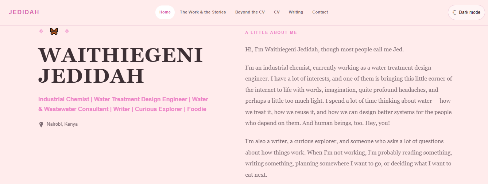

# Waithiegeni Jedidah

  

**Industrial Chemist · Water Treatment Design Engineer · Writer**

I believe engineering has its greatest impact when it quietly makes everyday life better.

I work in water treatment design, where chemistry, analysis, and practical engineering come together to solve real problems. Beyond my day-to-day work, I am interested in water reuse, circular water systems, and ways to make reliable access to water more achievable, especially for communities where water remains a constant struggle.

I am still learning, still asking questions, and still figuring out how to turn the things I care about into things I can build.

This portfolio brings together my professional experience, the stories behind it, my writing, and the things that don't quite fit on a CV.

## A little about my work

- **Water treatment:** Designing treatment systems around client requirements, raw water analysis, and the quality of water needed.
- **Chemistry and quality control:** Building on laboratory experience, analytical testing, and industrial quality control.
- **People and problem-solving:** Looking beyond the technical task to the people, processes, and everyday realities surrounding it.
- **Water reuse and circular systems:** Exploring how water can be treated, reused, and managed so that every drop has the opportunity to serve more than one purpose.

## Beyond the CV

I write, observe, ask questions, and collect stories. Some of what shapes me belongs in a laboratory or a treatment plant; some of it belongs in conversations, notebooks, and the ordinary moments that teach us something about being human.

Not everything meaningful fits neatly into a professional title. This space makes room for that, too.

## Find me around the internet

- **[Portfolio](https://sheisjed.github.io/Nyasha/#/)**
- **[Work Experience](https://sheisjed.github.io/Nyasha/#/work-experience)**
- **[Beyond the CV](https://sheisjed.github.io/Nyasha/#/things-that-dont-fit)**
- **[LinkedIn](https://linkedin.com/in/waithiegeni-jedidah/)**
- **Email:** [jedidahgithinji12@gmail.com](mailto:jedidahgithinji12@gmail.com)

---

*Built with React, TypeScript, and Vite. Made with care, curiosity, and a belief that the things we build should make life a little better.*